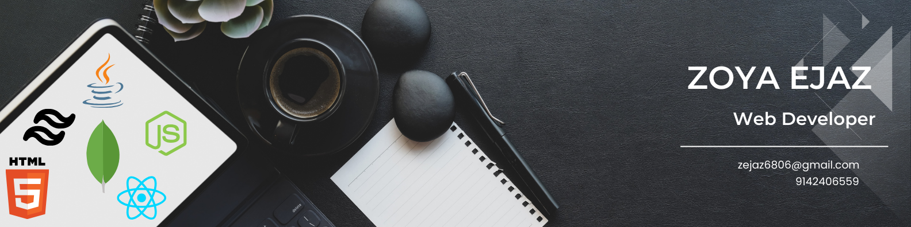

<h1 align="center">Hi 👋, I'm Zoya Ejaz</h1>

  

  

  
  
  

---

### 🚀 About Me

- 🎓 Pre-final year **B.Tech CSE (AI & ML)** student at **VIT Bhopal University**, Class of 2027 — **CGPA 8.83**
- 🏆 **Smart India Hackathon (SIH) 2024 Finalist**
- 🔬 Author of an **IEEE research paper** on automated glaucoma classification (ensemble ML on the RIM-ONE r12 dataset)
- 💼 Former intern at **Mittal Alliance Industries**, and Placement Cell coordinator managing large-scale student placement operations
- 🌱 Active member of **The Eureka Club** at VIT Bhopal
- 🛠️ I build **end-to-end products** — from ML models to production-ready full-stack apps — with a focus on real-world, social-impact problems
- 📫 Currently open to **SDE, Backend Engineering, and ML internship/full-time roles**

---

### 🧩 Featured Projects

<table>
  <tr>
    <td width="50%" valign="top">
      <b>♻️ KabadBecho</b> 
      A three-sided scrap marketplace connecting sellers, collectors, and recyclers, with Uber-style real-time collector dispatch mechanics.
    </td>
    <td width="50%" valign="top">
      <b>🩺 Punarvas</b> 
      An AI physiotherapy companion using MediaPipe Pose for real-time joint-angle detection, with multilingual (English/Hindi/Marathi) and privacy-first, client-side architecture.
    </td>
  </tr>
  <tr>
    <td width="50%" valign="top">
      <b>👁️ Automated Glaucoma Classification (IEEE)</b> 
      Research paper using Improved Empirical Mode Decomposition (IEMD) with an SVM + Random Forest + Gradient Boosting ensemble classifier for glaucoma detection.
    </td>
    <td width="50%" valign="top">
      <b>💊 Saheli AI (Bharat-Physio)</b> 
      Built for Meesho's "Scripted by Her" hackathon — an agentic AI architecture designed around Bharat-focused impact and women's empowerment.
    </td>
  </tr>
</table>

---

### 🛠 Tech Stack

**Languages**
 

**Frontend**
 

**Backend & Databases**
 

**ML / Data**
 

**Tools & Platforms**
 

---

### 🔥 GitHub Streak

### 🏆 Trophies

### 📈 Contribution Activity

### 📊 Stats Overview

<b>🔍 More GitHub Stats (profile cards)</b>

 

 

### 🌐 Connect With Me

<!-- Proudly enhanced with real project details -->
